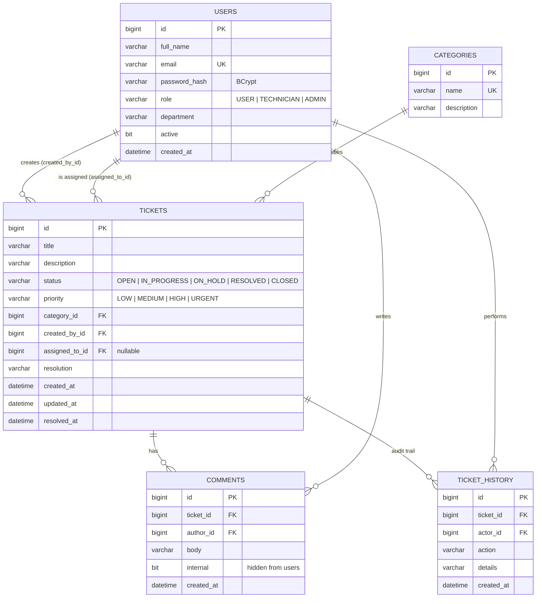

# SmartDesk database design — owner: Oshani

MySQL 8, database `smartdesk`, engine InnoDB, charset `utf8mb4`.
Scripts: `database/schema.sql` (tables), `database/seed.sql` (sample data), `database/test-queries.sql` (verification).

## ER diagram



(GitHub and VS Code render this diagram. For the report, paste it into <https://mermaid.live> and export as PNG.)

## Tables

| Table | Purpose | Key rules |
|---|---|---|
| `users` | All accounts. Role decides permissions. | `email` unique; passwords stored only as BCrypt hashes; users with activity are deactivated, not deleted |
| `categories` | Ticket classification (Hardware, Network…) | `name` unique; cannot delete a category in use |
| `tickets` | The support requests | always has a creator; `assigned_to_id` NULL = unassigned queue; `resolved_at` set when RESOLVED/CLOSED |
| `comments` | Conversation on a ticket | `internal = 1` → visible to technicians/admins only |
| `ticket_history` | Who did what and when | written automatically by the backend on create/assign/status/priority/update |

## Relationships
* users 1 — N tickets (as creator)
* users 1 — N tickets (as assigned technician, optional)
* categories 1 — N tickets (optional)
* tickets 1 — N comments, users 1 — N comments
* tickets 1 — N ticket_history, users 1 — N ticket_history

## Normalisation
All tables are in 3NF: every non-key column depends only on the primary key; user names and category names
are never duplicated inside `tickets` (only foreign keys are stored).

## Indexes
`tickets.status`, `tickets.created_by_id`, `tickets.assigned_to_id`, `comments.ticket_id`, `ticket_history.ticket_id`
— these support the most frequent queries (My Tickets, Assigned to Me, status filters, ticket details).

## Backup / restore (Day 11)
```bash
mysqldump -u root -p --single-transaction smartdesk > smartdesk_backup.sql
mysql -u root -p smartdesk < smartdesk_backup.sql
```
